# Console Translator Android: hướng dẫn bằng hình

[Tải trên Google Play](https://play.google.com/store/apps/details?id=com.kyozx.consoletranslator) · [Xem hướng dẫn trên web](https://kyozxx.github.io/Console-Translator/guide.html)

Bật phụ đề trong game. Nếu dùng Remote Play, mở được hình game trên điện thoại trước.

## Chơi máy PX5 / PX4: chuẩn bị một lần

Console Translator **tự kết nối với máy chơi game**, không cần app khác. Trên máy PX5, làm một lần:

1. Thêm một **người chơi phụ** (tài khoản phụ) và đăng nhập một lần. Ghép nối bằng người chơi phụ thì người chơi chính vẫn chơi tiếp bằng tay cầm trên TV.
2. **Cài đặt → Hệ thống → Chơi từ xa**: bật **Bật Chơi từ xa** cho người chơi phụ.
3. Nên bật **Cài đặt → Hệ thống → Tiết kiệm điện → Tính năng khi ở chế độ nghỉ → Giữ kết nối Internet** và **Cho phép bật máy qua mạng** để app tự bật máy đang nghỉ.

Điện thoại và máy PX5 dùng chung một mạng Wi-Fi.

## 1. Bấm Bắt đầu dịch game

Chọn **Chơi trên TV** (game vẫn hiện trên TV, điện thoại hiện bản dịch và đọc thoại) hoặc **Chơi trên điện thoại**. Chơi trên điện thoại có 2 cách: **Chơi trực tiếp trong app** hoặc **Dùng app PXPlay hoặc Chiaki** (xem mục cuối).

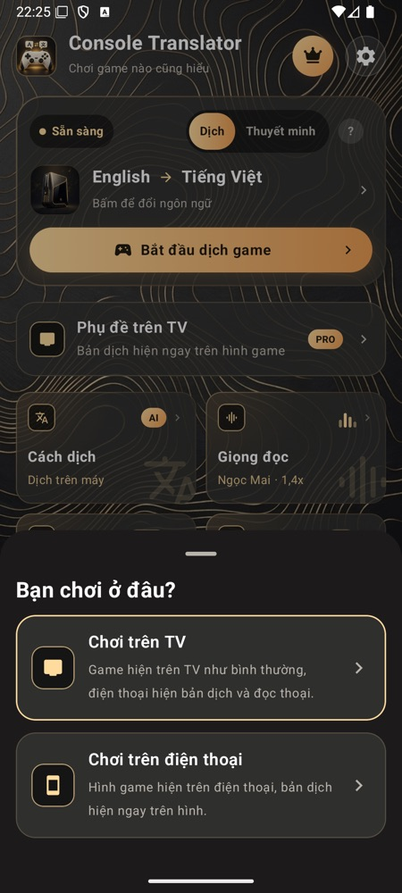 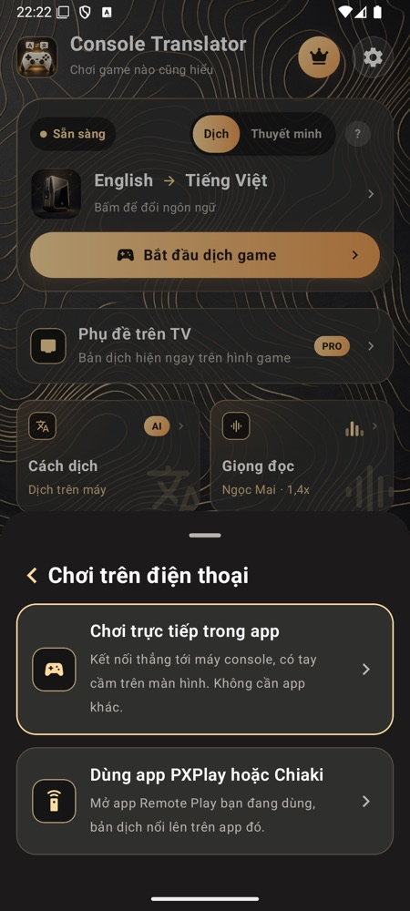

## 2. Ghép nối máy (chỉ một lần)

1. **Tìm máy:** bấm Tìm máy. Không thấy thì nhập IP ở mục *Không tìm thấy? Nhập địa chỉ bằng tay*.
2. **Mã người chơi:** mở [id.kyozx.cloud](https://id.kyozx.cloud), nhập Online ID của người chơi phụ, bấm **Tra**, bấm **Sao chép** rồi về app bấm **Dán mã**.
3. **Mã trên máy:** trên PX5 vào **Cài đặt → Hệ thống → Chơi từ xa → Liên kết thiết bị**, nhập 8 chữ số rồi bấm **Ghép nối**.

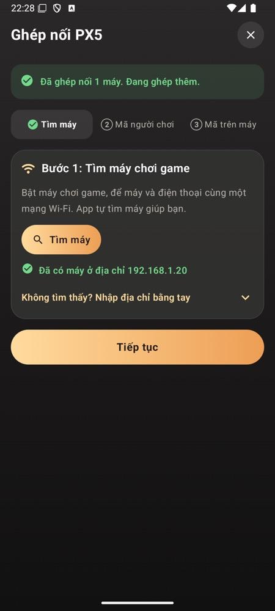 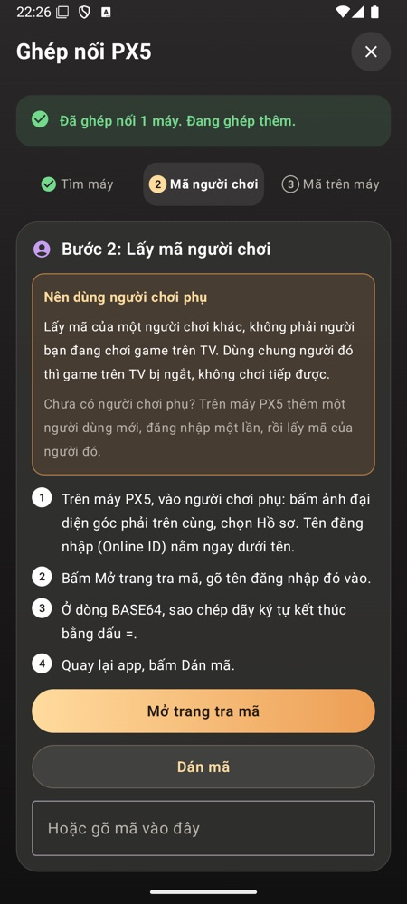 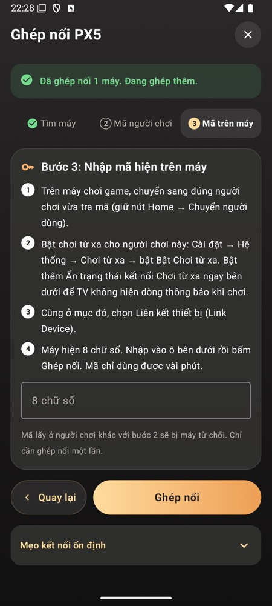

## 3. Chọn game và người chơi

Ở màn **Kết nối**: bấm **Game đang chơi** để chọn hoặc **Thêm game khác…** (có danh sách game để Dịch AI giữ đúng tên nhân vật và xưng hô). Chọn người chơi dùng **khi dịch** và **khi chơi trên điện thoại**.

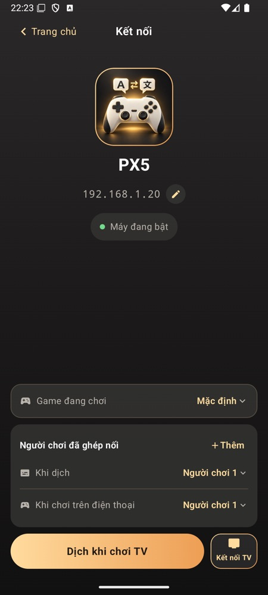

## 4. Dịch khi chơi TV

Bấm **Dịch khi chơi TV**. Tay cầm tắt một lát là bình thường: bấm nút Home trên tay cầm rồi chọn lại người chơi của bạn trên TV. Bản dịch hiện ở hộp dưới cùng và được đọc to; chạm để đọc lại, kéo lên xuống để đổi chỗ. Nút mặt trăng tắt màn hình mà vẫn dịch.

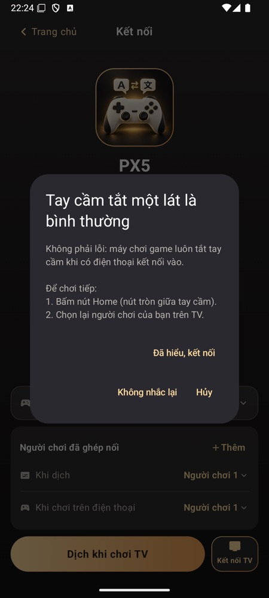 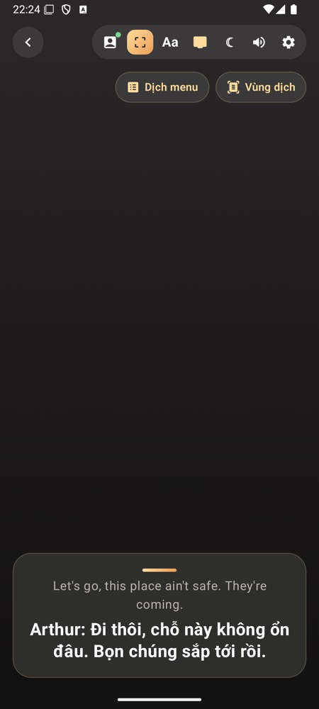

## 5. Đặt khung phụ đề

Chưa dịch? Kiểm tra bước này trước. Bấm **nút vàng**, kéo khung vàng phủ lên chỗ phụ đề tiếng Anh trong game, kéo chấm ở góc để đổi cỡ, rồi bấm **Lưu khung**.

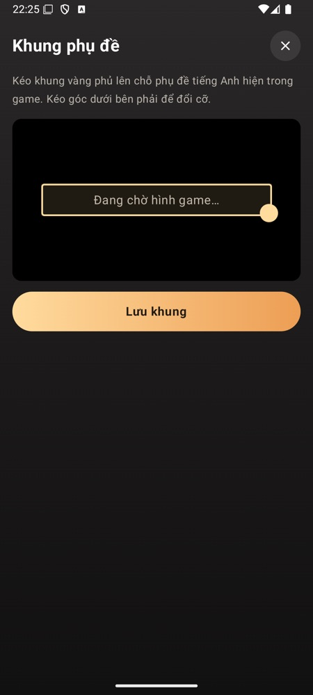

## 6. Dịch menu và Vùng dịch

**Dịch menu** dịch chữ đang hiện (kỹ năng, túi đồ, nhiệm vụ); giữ nút để bật tự động. **Vùng dịch** hiện hình game: kéo khung cam tới chữ cần dịch rồi thả tay.

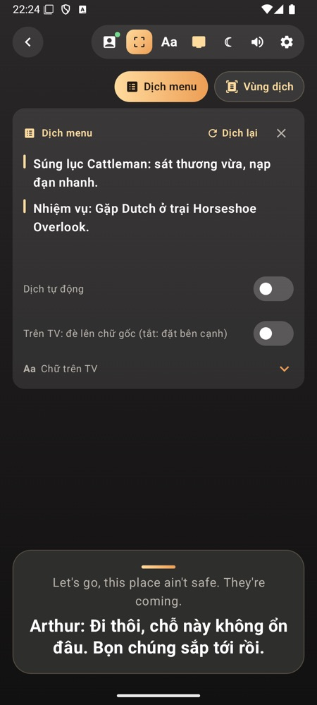 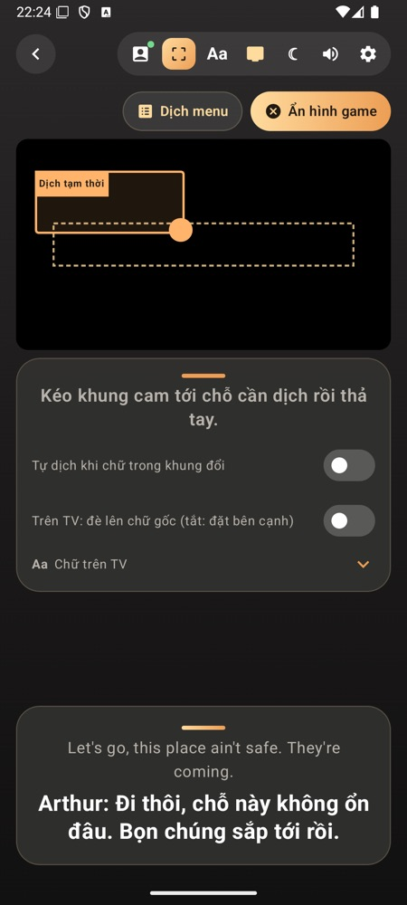

## 7. Chơi trên điện thoại

Chọn **Chơi trên điện thoại → Chơi trực tiếp trong app**, chọn chất lượng hình rồi bấm **Chơi**. Bản dịch hiện ngay trên hình; chạm vào hình để hiện thanh nút.

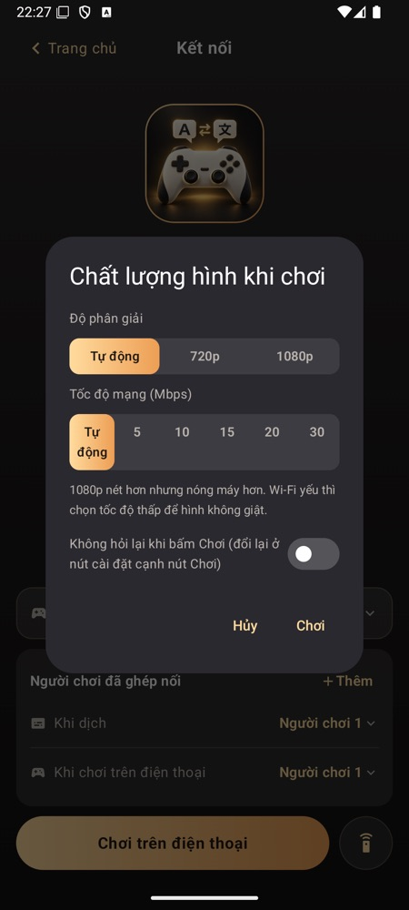

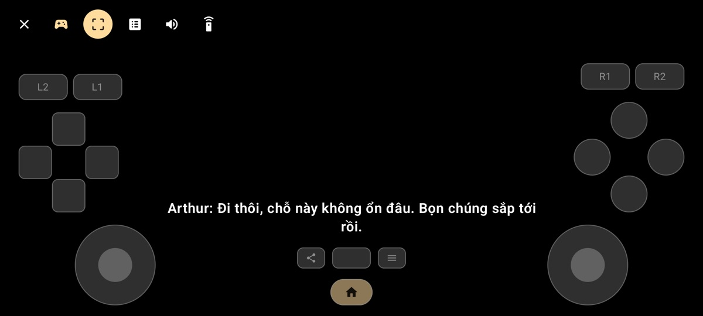

## Chơi máy Xbox trong app

App tự kết nối với máy Xbox, không cần app khác. Trên máy Xbox, làm một lần:

1. **Cài đặt → Thiết bị & kết nối → Tính năng từ xa**: bật **Tính năng từ xa**.
2. **Cài đặt → Chung → Tùy chọn nguồn**: chọn **Ngủ (Sleep)**. Ở chế độ **Tắt máy (tiết kiệm điện)** app không bật được máy và không kết nối được.
3. Trong **Tính năng từ xa**, bấm **Test remote play** để kiểm tra: mục dấu đỏ là phải sửa, dấu vàng vẫn chơi được.

Trong app:

1. **Bắt đầu dịch game → Xbox**, rồi chọn **Dịch khi chơi TV** hoặc **Chơi trên điện thoại**.
2. Bấm **Đăng nhập**: app hiện một mã. Mở trang Microsoft, nhập mã, đăng nhập tài khoản đang dùng trên máy Xbox. App không thấy mật khẩu.
3. Chọn máy Xbox của bạn. Không thấy máy: trên máy vào **Cài đặt → Hệ thống → Thông tin máy**, chép **Console ID** vào ô trong app.

App tự tìm máy trong Wi-Fi và tự bật máy đang ngủ. Kết nối không được thì vào **Cài đặt → Nhật ký lỗi → Gửi nhật ký** để gửi cho nhóm hỗ trợ.

## Dùng app PXPlay hoặc Chiaki (cách cũ)

Chọn **Chơi trên điện thoại → Dùng app PXPlay hoặc Chiaki**. Bản dịch nổi lên trên app Remote Play bạn đang dùng.

### App Remote Play bên ngoài

Bắt buộc nếu game chạy trên máy chơi game. Chơi game điện thoại hoặc xem YouTube thì bỏ qua phần này.

Console Translator chỉ đọc và dịch chữ **đang hiện trên màn hình điện thoại**, không tự kết nối được với máy chơi game. Bạn cần một app Remote Play riêng để đưa hình game về điện thoại.

> Đây là app bên ngoài của nhà phát triển khác, **không thuộc Console Translator**. Chúng tôi không làm ra và không hỗ trợ các app này. Bạn chọn app nào cũng được.

- [Chiaki-Up](https://play.google.com/store/apps/details?id=com.gameblabla.chiaki): miễn phí, Google Play.
- [PXPlay](https://play.google.com/store/apps/details?id=psplay.grill.com): trả phí, Google Play.

**Chiaki-Up báo không tìm được tài khoản?** Chức năng tìm tài khoản theo tên trong Chiaki-Up hiện đang lỗi. Mở trang [id.kyozx.cloud](https://id.kyozx.cloud), nhập tên tài khoản PSN để lấy **Account ID**, rồi dán Account ID đó vào Chiaki-Up khi ghép máy. Đây là trang bên ngoài, không thuộc Console Translator.

1. Mở app Remote Play vừa cài và ghép với máy chơi game.
2. Vào được **hình game trên điện thoại**.
3. Mở Console Translator, bấm **Bắt đầu dịch**. Khi Android hỏi, chọn chia sẻ **đúng app Remote Play đó**.

### 1. Cấp quyền hiện nổi

Mở Console Translator, bấm **Cho phép hiện nổi**.

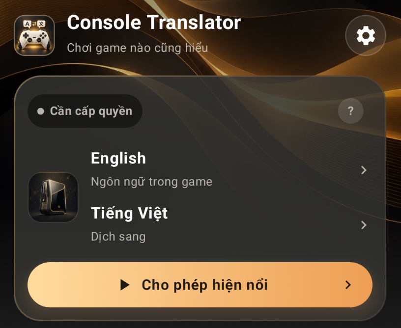

### 2. Bật quyền cho app

Nếu hiện danh sách ứng dụng, chọn **Console Translator**. Bật **Cho phép hiện trên các ứng dụng khác**, rồi quay lại app.

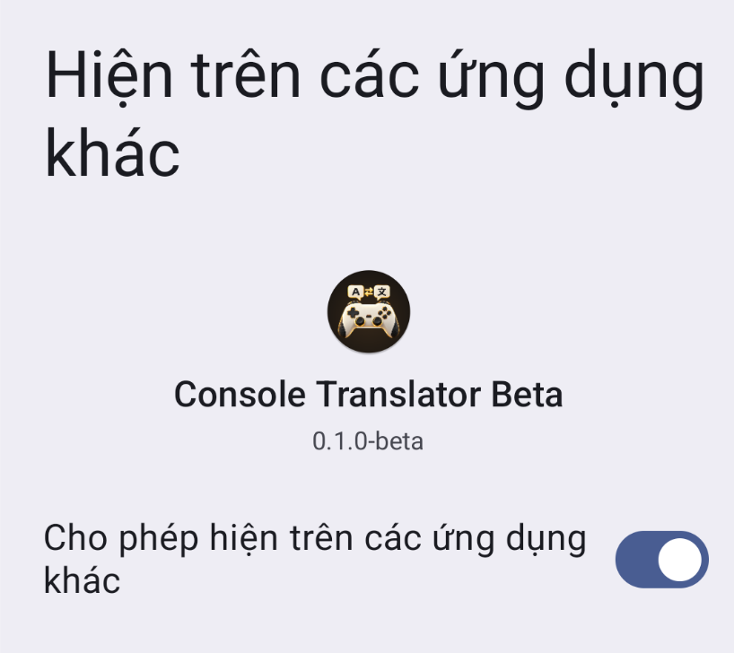

### 3. Tải ngôn ngữ và giọng đọc

Chọn ngôn ngữ trong game và ngôn ngữ dịch sang, rồi bấm **Bắt đầu dịch**. Nếu app mở **Tải ngôn ngữ**, tải các gói còn thiếu.

Muốn nghe bản dịch, tải thêm giọng của ngôn ngữ dịch sang. Nếu hiện **Đã có** hoặc **Xóa** thì gói đó đã được tải. Xong, đóng màn hình này để quay lại.

Game tiếng Anh đã có bộ đọc chữ. Tiếng Trung, Nhật, Hàn cần tải thêm gói đọc chữ tương ứng; dịch trên máy cần gói dịch của cặp ngôn ngữ.

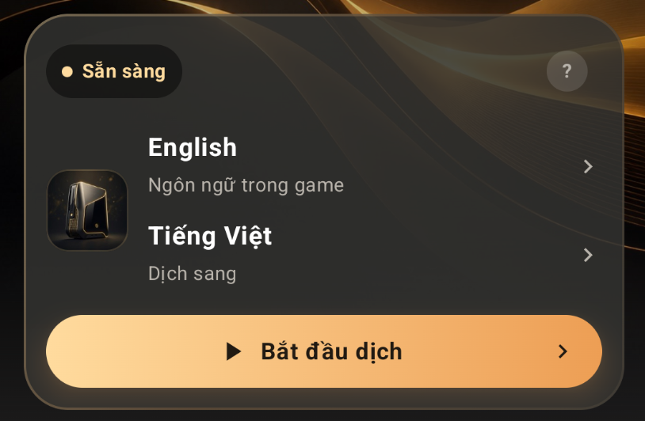

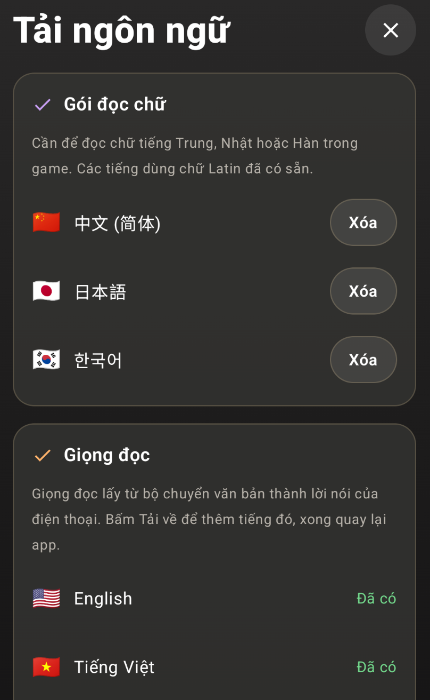

### 4. Chọn ứng dụng cần dịch

Bấm **Bắt đầu dịch** lần nữa. Khi Android hỏi, chọn **Chia sẻ một ứng dụng → Tiếp theo**, rồi chọn game hoặc app Remote Play đang dùng.

Chơi PX5 / PX4: mở hình game bằng app Remote Play trước (xem mục **Chơi máy PX5 / PX4? Cài app Remote Play trước** ở đầu trang), rồi chọn chia sẻ đúng app đó.

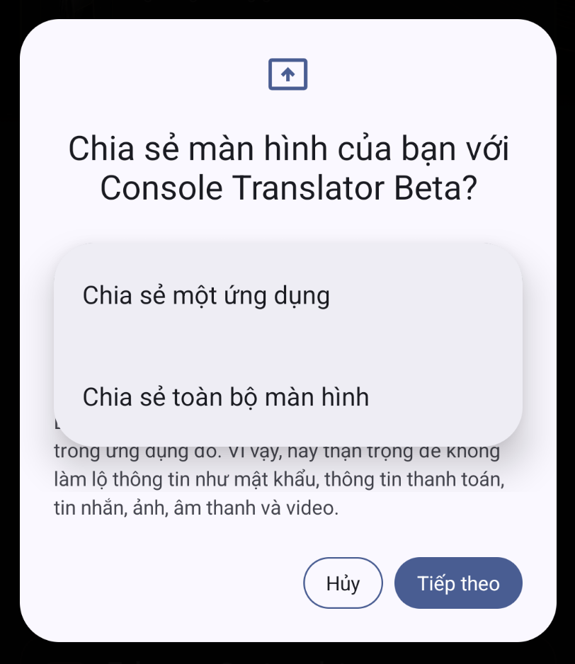

### 5. Chọn vùng chữ, rồi chạy dịch

Bật phụ đề trong game. Bấm nút **khung quét**, kéo khung bao quanh chữ gốc và bấm **Xong**. Sau đó bấm **tam giác chạy** để bắt đầu dịch.

Các nút dưới đây được xếp từ trái sang phải như trong ảnh.

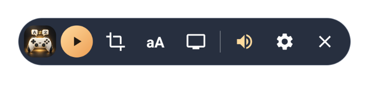

- **Logo app:** Bấm để thu gọn hoặc mở thanh nút. Giữ và kéo logo để di chuyển thanh.
- **Chạy / Tạm dừng:** Bấm nút tam giác để dịch; bấm lại để tạm dừng mà vẫn giữ thanh nổi.
- **Khung quét:** Chọn vùng có chữ gốc. Kéo để di chuyển, kéo góc để đổi kích thước, rồi bấm Xong.
- **aA · Kiểu phụ đề:** Đổi cỡ chữ, màu chữ, nền và bật/tắt hiển thị chữ gốc cùng bản dịch.
- **Màn hình TV:** Xem trạng thái và kết nối lại TV đã ghép. Ghép lần đầu trong Cài đặt → Phụ đề trên TV.
- **Loa · Đọc bản dịch:** Bật hoặc tắt đọc to. Dùng giọng của ngôn ngữ dịch sang đã tải trên điện thoại.
- **Bánh răng · Chỉnh nhanh:** Đổi cách dịch, phong cách, giọng đọc, tốc độ quét hoặc hồ sơ game. Có lối mở cài đặt đầy đủ.
- **Dấu X · Kết thúc:** Dừng phiên dịch và đóng thanh nổi. Muốn dịch lại, mở app và bấm Bắt đầu dịch.

### Dịch nhiệm vụ, vật phẩm, bảng lựa chọn

Từ bản 0.1.17, nút **khung quét** có thêm **Chọn vùng dịch**. Kéo khung lên nhiệm vụ, mô tả vật phẩm hay bảng lựa chọn rồi bấm **Dịch**. App đọc một lần và hiện bản dịch đúng chỗ chữ gốc trong khoảng 12 giây, mỗi lựa chọn một dòng; chạm vào bản dịch để tắt sớm. Nếu đang nối TV, bản dịch cũng hiện trên TV (cần app TV 0.2.3 trở lên).

## Không dịch được, kiểm tra nhanh

- **Chọn nhầm app khi chia sẻ:** chọn đúng game, YouTube hoặc app Remote Play đang có hình, không chọn app đứng đầu danh sách nếu đó là app khác (ví dụ app nhắn tin).
- **Không có phụ đề trên màn hình:** bật phụ đề trong game, hoặc nút CC trên YouTube. App chỉ đọc chữ đang hiện.
- **Chưa bấm nút chạy:** thanh nổi bắt đầu ở trạng thái tạm dừng, bấm tam giác vàng để quét.
- **Máy lag:** giảm tốc độ quét trong bánh răng trên thanh nổi.

## Hướng dẫn thêm

Phần cài APK, TV LG, Android TV và xử lý lỗi được thu gọn ở cuối [trang hướng dẫn](https://kyozxx.github.io/Console-Translator/guide.html).

## Cài app nhận phụ đề trên Android TV

Cần **Android TV / Google TV 9 trở lên**. Xem phiên bản: Cài đặt → Tùy chọn thiết bị → Giới thiệu.

| Loại TV | Mã Downloader | APK |
| --- | --- | --- |
| Android TV / Google TV thông thường | **8179089** | [TV 2.0.9](https://api.kyozx.cloud/tv/latest) |
| Xiaomi nội địa Trung Quốc | **2484675** | [TV 2.0.9-mi](https://api.kyozx.cloud/tv/latest-mi) |

1. Trên TV, cài Downloader by AFTVnews từ Google Play nếu có. Cho phép Downloader cài APK trong Cài đặt → Ứng dụng → Quyền truy cập đặc biệt → Cài đặt ứng dụng không rõ nguồn.
2. Nhập mã đúng loại TV, tải và cài Console Translator TV. Bản Xiaomi có đuôi -mi.
3. Mở app nhận, cấp quyền hiển thị trên ứng dụng khác, rồi bấm Back. Cho phép bỏ qua tối ưu hóa pin nếu được hỏi.
4. Sau khi cài đặt xong, bật máy PS5 trên TV rồi mở app nhận phụ đề:
   - **Samsung:** Bấm mở trực tiếp app trên TV.
   - **LG webOS:** Trong app Android, vào Cài đặt → Phụ đề trên TV → Mở app đã cài (hoặc mở qua PC).
   - **Android TV / Google TV:** Bấm mở trực tiếp app Console Translator TV trên TV.

Màn hình TV sẽ hiển thị **Địa chỉ TV** và **Mã ghép nối (8 số)**:

| Màn hình TV LG | Màn hình Android TV |
| :---: | :---: |
| 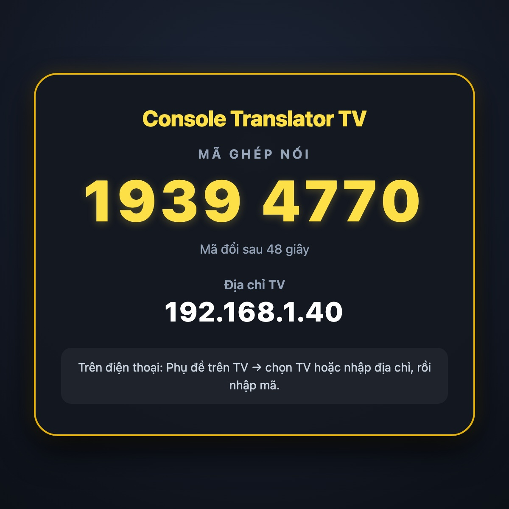 | 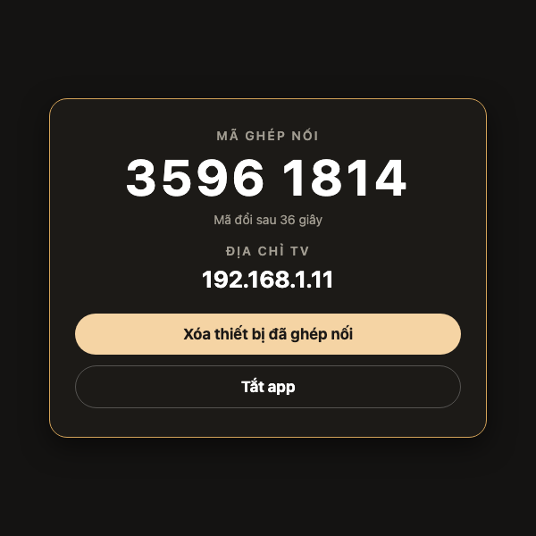 |

5. Trên điện thoại (cùng mạng Wi-Fi với TV):
   - Mở app, vào **Cài đặt → Phụ đề trên TV**.
   - Nhập **Địa chỉ TV** và **Mã 8 số** đang hiện trên TV, bấm **Kết nối**.
6. Chuyển TV sang cổng HDMI của máy chơi game (PS5 / PS4 / Xbox). Giữ hình game trên điện thoại, chọn vùng chữ và bấm chạy dịch để phụ đề nổi trên TV.

Mã Downloader chỉ dùng tải APK TV, khác mã beta và mã ghép phụ đề 8 số. Từ bản 0.2.3, app TV tự hiện nút Cập nhật khi có bản mới.

### Xiaomi nội địa

- Dùng bản 2.0.9-mi; Xiaomi quốc tế chạy Android TV / Google TV dùng bản thường.
- Phụ đề chỉ hiện sau khi rời màn hình app nhận và chuyển sang HDMI. Không bấm Tắt app trước khi chơi.
- Nếu không có Google Play / Downloader, tải APK đúng loại bằng link trên, chép vào USB và cài bằng trình quản lý tệp của TV. Cho phép ứng dụng đó cài APK khi được hỏi; menu tùy TV.
- Nếu bản thường bị đóng trên TV nội địa, dùng bản -mi, cấp quyền và ghép lại bằng mã 8 số của bản đó.

**Xiaomi nội địa không bật được quyền hiển thị trên ứng dụng khác?**

1. TV: **Settings → Accounts and Security → ADB** → bật, chọn **ALLOW**.
2. Mở app **Permissions Manager** (khiên xanh).
3. Chọn **Console Translator TV (Mi)** → `android.permission.SYSTEM_ALERT_WINDOW` → **Allow**.

Một số phần mềm TV khóa quyền hiện nổi. APK này không dành cho LG webOS hoặc Samsung Tizen.

## TV Samsung

Chỉ TV Samsung từ 2017 trở lên (Tizen 3.0+); TV 2016 trở về trước không dùng được. Cài thử app TV trước khi donate, xem [TV nào dùng được](SAMSUNG.md#tv-nào-dùng-được).

Xem [hướng dẫn cài TV Samsung bằng PC hoặc Mac](SAMSUNG.md). Có link tải Windows 1.0.18 và Mac 1.0.15, cách bật Developer Mode, nhận mã `SSTV-…` và ghép phụ đề.

## TV LG webOS

Xem [hướng dẫn cài TV LG bằng PC](LG.md). Có link tải Windows 1.2.17, hướng dẫn nhận mã `LGTV-…`, bật Developer Mode, mở app TV và ghép phụ đề Android. Nếu không có PC, bản beta Android có thể cài trực tiếp trong Cài đặt → Phụ đề trên TV → Cài cho TV LG webOS.
